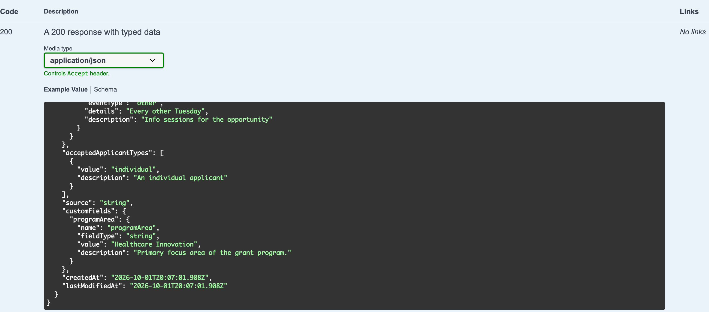

import {
  FileTree,
  Steps,
  CardGrid,
  LinkCard,
  Tabs,
  TabItem,
} from "@astrojs/starlight/components";

Welcome to our docs! Learn how to get started with the CommonGrants protocol.

Looking to jump right in? Skip to the [quickstart tutorial](#quickstart) to define a CommonGrants API using TypeSpec and explore the core routes and models defined by the protocol.

## Find your way around

Not looking for a quickstart guide? Here are some other resources to help you get started:

<CardGrid>
  <LinkCard
    title="About CommonGrants"
    href="/about/"
    description="Understand the vision and goals behind the CommonGrants protocol."
  />
  <LinkCard
    title="API docs"
    href="/protocol/api-docs/"
    description="Browse the API endpoints supported by CommonGrants APIs."
  />
  <LinkCard
    title="CommonGrants models"
    href="/protocol/models/"
    description="Explore the core models defined by the CommonGrants protocol."
  />
  <LinkCard
    title="Specification"
    href="/protocol/specification/"
    description="Deep dive into the technical details of the CommonGrants protocol."
  />
</CardGrid>

## Quickstart

In this tutorial you will:

- Define a CommonGrants API specification with TypeSpec
- Compile it to OpenAPI and preview it with Swagger
- Add a custom field and see it in the docs

You'll end up with an API specification and a docs preview, not a running API.

:::note[Prerequisites]

- [Node.js](https://nodejs.org/) v22 or later (check with `node --version`). Bun users need Node.js too.
- One package manager: [pnpm](https://pnpm.io/installation), [npm](https://docs.npmjs.com/downloading-and-installing-node-js-and-npm), or [Bun](https://bun.sh/docs/installation).
- Port `3000` free for the preview server.

:::

### First steps

Set up and preview the default CommonGrants API specification.

#### 1. Create a new directory for your project

```bash
mkdir common-grants-quickstart
cd common-grants-quickstart
```

#### 2. Create a `package.json` file

```json title=package.json
{
  "name": "common-grants-quickstart",
  "private": true,
  "type": "module"
}
```

#### 3. Install the dependencies

<Tabs syncKey="pkg-manager">
<TabItem label="pnpm">

pnpm stops on unapproved install scripts. Create `pnpm-workspace.yaml` to skip the one optional script in the CLI's dependencies:

```yaml title=pnpm-workspace.yaml
allowBuilds:
  "@scarf/scarf": false
```

Then install the packages:

```bash
pnpm add --save-exact @common-grants/core@0.5.0 @common-grants/cli@0.5.1 @typespec/compiler@1.17.0 @typespec/http@1.17.0 @typespec/openapi@1.17.0 @typespec/openapi3@1.17.0 @typespec/json-schema@1.17.0 @typespec/rest@0.87.0 @typespec/versioning@0.87.0
```

</TabItem>
<TabItem label="npm">

```bash
npm install --save-exact @common-grants/core@0.5.0 @common-grants/cli@0.5.1 @typespec/compiler@1.17.0 @typespec/http@1.17.0 @typespec/openapi@1.17.0 @typespec/openapi3@1.17.0 @typespec/json-schema@1.17.0 @typespec/rest@0.87.0 @typespec/versioning@0.87.0
```

</TabItem>
<TabItem label="bun">

```bash
bun add --exact @common-grants/core@0.5.0 @common-grants/cli@0.5.1 @typespec/compiler@1.17.0 @typespec/http@1.17.0 @typespec/openapi@1.17.0 @typespec/openapi3@1.17.0 @typespec/json-schema@1.17.0 @typespec/rest@0.87.0 @typespec/versioning@0.87.0
```

</TabItem>
</Tabs>

#### 4. Create the TypeSpec project files

```tsp title=main.tsp
import "@typespec/http";
import "@typespec/versioning";
import "@common-grants/core";

import "./routes.tsp";

/** API description here */
@service(#{ title: "Quickstart API" })
@Versioning.useDependency(CommonGrants.Versions.v0_5)
namespace Quickstart;
```

```tsp title=routes.tsp
import "@common-grants/core";

using TypeSpec.Http;

@tag("Opportunities")
@route("/common-grants/opportunities")
namespace Quickstart.Routes {
  alias OpportunitiesRouter = CommonGrants.Routes.Opportunities;

  op list is OpportunitiesRouter.list;
  op read is OpportunitiesRouter.read;
  op search is OpportunitiesRouter.search;
}
```

```yaml title=tspconfig.yaml
emit:
  - "@typespec/json-schema"
  - "@typespec/openapi3"
```

#### 5. Compile your API specification

<Tabs syncKey="pkg-manager">
<TabItem label="pnpm">

```bash
pnpm exec cg compile main.tsp
```

</TabItem>
<TabItem label="npm">

```bash
npm exec -- cg compile main.tsp
```

</TabItem>
<TabItem label="bun">

```bash
bun run cg compile main.tsp
```

</TabItem>
</Tabs>

#### 6. Preview your API specification at `http://localhost:3000`

<Tabs syncKey="pkg-manager">
<TabItem label="pnpm">

```bash
pnpm exec cg preview tsp-output/@typespec/openapi3/openapi.Quickstart.yaml
```

</TabItem>
<TabItem label="npm">

```bash
npm exec -- cg preview tsp-output/@typespec/openapi3/openapi.Quickstart.yaml
```

</TabItem>
<TabItem label="bun">

```bash
bun run cg preview tsp-output/@typespec/openapi3/openapi.Quickstart.yaml
```

</TabItem>
</Tabs>

Press `Ctrl+C` in the terminal to stop the preview server when you're done.

### Deep dive

A closer look at the files and packages you just created. To skip ahead, go to [Customization](#customization).

:::tip
To make the deep dive sections easier to follow, we recommend installing the [TypeSpec VSCode extension](https://marketplace.visualstudio.com/items?itemName=typespec.typespec-vscode) which provides syntax highlighting and autocomplete for TypeSpec files.
:::

#### Explore the files you created

Your project directory now contains the following files:

<FileTree>

- main.tsp # Defines the API service
- routes.tsp # Defines the API routes
- tspconfig.yaml # Configures TypeSpec emitters (e.g. OpenAPI)
- package.json # Manages project dependencies
- pnpm-workspace.yaml # pnpm only: skips an optional install script
- tsp-output/ # Created when you compile

</FileTree>

We'll focus on exploring the following files in particular:

- [`routes.tsp`](#understanding-routestsp)
- [`main.tsp`](#understanding-maintsp)
- [`tspconfig.yaml`](#understanding-tspconfigyaml)

##### Understanding `routes.tsp`

The `routes.tsp` file is the TypeSpec file that defines the API routes.

```tsp title=routes.tsp
import "@common-grants/core";

using TypeSpec.Http;

@tag("Opportunities")
@route("/common-grants/opportunities")
namespace Quickstart.Routes {
  alias OpportunitiesRouter = CommonGrants.Routes.Opportunities;

  op list is OpportunitiesRouter.list;
  op read is OpportunitiesRouter.read;
  op search is OpportunitiesRouter.search;
}
```

Since there's a lot happening here, let's break it down section by section.

<Steps>

1. Import the CommonGrants TypeSpec library.

   ```tsp
   import "@common-grants/core";
   ```

2. Expose the `TypeSpec.Http` namespace.

   ```tsp
   using TypeSpec.Http;
   ```

   This makes the `@route` decorator available in the current namespace without requiring the `TypeSpec.Http` prefix. (`@tag` is built into TypeSpec and needs no import.)

3. Define a namespace for the `OpportunitiesRouter`.

   ```tsp
   @tag("Opportunities")
   @route("/common-grants/opportunities")
   namespace Quickstart.Routes {
     alias OpportunitiesRouter = CommonGrants.Routes.Opportunities;
     // operations omitted for brevity
   }
   ```

   Think of the `OpportunitiesRouter` as a controller in a traditional MVC framework that groups related routes together under the `Opportunities` tag and exposes them at the `/common-grants/opportunities` path.

4. Expose the default routes from the CommonGrants library.

   ```tsp {6-8}
   @tag("Opportunities")
   @route("/common-grants/opportunities")
   namespace Quickstart.Routes {
     alias OpportunitiesRouter = CommonGrants.Routes.Opportunities;

     op list is OpportunitiesRouter.list;
     op read is OpportunitiesRouter.read;
     op search is OpportunitiesRouter.search;
   }
   ```

   This exposes the following default routes from the CommonGrants library:
   - `GET /common-grants/opportunities`
   - `GET /common-grants/opportunities/{oppId}`
   - `POST /common-grants/opportunities/search`

</Steps>

##### Understanding `main.tsp`

The `main.tsp` file is the TypeSpec file that defines the API service.

```tsp title=main.tsp
import "@typespec/http";
import "@typespec/versioning";
import "@common-grants/core";

import "./routes.tsp";

/** API description here */
@service(#{ title: "Quickstart API" })
@Versioning.useDependency(CommonGrants.Versions.v0_5)
namespace Quickstart;
```

Let's break down the `main.tsp` file section by section.

<Steps>

1. Import the TypeSpec libraries and the `routes.tsp` file.

   ```tsp
   import "@typespec/http";
   import "@typespec/versioning";
   import "@common-grants/core";

   import "./routes.tsp";
   ```

   Importing the `routes.tsp` includes the routes from that file in the OpenAPI document generated when you compile.

2. Define the API service.

   ```tsp {2}
   /** API description here */
   @service(#{ title: "Quickstart API" })
   @Versioning.useDependency(CommonGrants.Versions.v0_5)
   namespace Quickstart;
   ```

   This defines the API service with a title of "Quickstart API". The `@service` decorator is required for the OpenAPI emitter to work. The `title` property is used to set the title of the API and the docstring is used to set the description of the API in the OpenAPI docs.

3. Specify the version of the CommonGrants protocol to use.

   ```tsp {3}
   /** API description here */
   @service(#{ title: "Quickstart API" })
   @Versioning.useDependency(CommonGrants.Versions.v0_5)
   namespace Quickstart;
   ```

   This specifies that the Quickstart API should use the models and routes defined in the v0.5 version of the CommonGrants protocol.

</Steps>

##### Understanding `tspconfig.yaml`

The `tspconfig.yaml` file is the TypeSpec configuration file that defines the emitters for the project.

```yaml title=tspconfig.yaml
emit:
  - "@typespec/json-schema"
  - "@typespec/openapi3"
```

This configures the TypeSpec compiler to emit the API definition as an OpenAPI document and a JSON Schema.

#### Explore the packages you installed

You installed the following packages:

- [`@common-grants/core`](https://www.npmjs.com/package/@common-grants/core) The CommonGrants TypeSpec library, which includes a default set of models and routes that can be used to define your own CommonGrants API.
- [`@common-grants/cli`](https://www.npmjs.com/package/@common-grants/cli) The CommonGrants CLI (`cg`), which compiles your TypeSpec project and previews the OpenAPI document with Swagger UI.
- [`@typespec/compiler`](https://www.npmjs.com/package/@typespec/compiler) The TypeSpec compiler (`tsp`).
- [`@typespec/openapi3`](https://www.npmjs.com/package/@typespec/openapi3) The OpenAPI emitter for TypeSpec, which emits the CommonGrants API definition as an OpenAPI document.
- [`@typespec/json-schema`](https://www.npmjs.com/package/@typespec/json-schema) The JSON Schema emitter for TypeSpec, which emits the models in your CommonGrants API as JSON Schemas.
- `@typespec/http`, `@typespec/openapi`, `@typespec/rest`, and `@typespec/versioning` Supporting TypeSpec libraries that the CommonGrants library depends on.

#### Explore the files created by compiling

Compiling creates a `tsp-output` directory with the following files compiled from `main.tsp`:

<FileTree>

- `tsp-output/`
  - `@typespec/`
    - `openapi3/` Auto-generated by the OpenAPI emitter
      - `openapi.Quickstart.yaml` The Quickstart API spec
      - `openapi.CommonGrants.API.<version>.yaml` One base CommonGrants API spec per protocol version
    - `json-schema/` Auto-generated by the JSON Schema emitter
      - `CustomField.yaml`
      - `OpportunityBase.yaml`
      - ...

</FileTree>

#### Understanding the `cg preview` command

The `cg preview` command starts a local server that serves the OpenAPI specification using Swagger UI. View your API specification at `http://localhost:3000`.

The server reads the spec file once when it starts. If you recompile, stop the server with `Ctrl+C` and start it again to see your changes.

### Customization

Extend the base CommonGrants specification with a custom field.

#### Add a custom field to the `Opportunity` model

Create a new file called `models.tsp` with the following code:

```tsp title=models.tsp
import "@common-grants/core";

// Allows us to use models defined in the specification library
// without prefixing each model with `CommonGrants`
using CommonGrants.Models;
using CommonGrants.Fields;

namespace Quickstart.Models;

model ProgramArea extends CustomField {
  name: "programArea";
  fieldType: CustomFieldType.string;
  value: string;
  description: "Primary focus area of the grant program.";
}

// Create a custom Opportunity type by extending the base model
model CustomOpportunity extends OpportunityBase {
  @example(#{
    programArea: #{
      name: "programArea",
      fieldType: CustomFieldType.string,
      value: "Healthcare Innovation",
      description: "Primary focus area of the grant program.",
    },
  })
  customFields: {
    programArea: ProgramArea;
  };
}
```

There's a lot happening here, so let's break it down section by section.

<Steps>

1. Import the CommonGrants TypeSpec library.

   ```tsp
   import "@common-grants/core";
   ```

2. Make the CommonGrants fields, models, etc. available in the current namespace.

   ```tsp
   using CommonGrants.Models;
   using CommonGrants.Fields;
   ```

   Without this, you would have to prefix each model with `CommonGrants.Models` and each field with `CommonGrants.Fields`. For example `CommonGrants.Fields.CustomField`.

3. Declare a namespace for the current file.

   ```tsp
   namespace Quickstart.Models;
   ```

4. Define a custom field by extending the `CustomField` model.

   ```tsp
   model ProgramArea extends CustomField {
     name: "programArea";
     fieldType: CustomFieldType.string;
     value: string;
     description: "Primary focus area of the grant program.";
   }
   ```

   The `ProgramArea` model defines literal values for the field's `name`, `fieldType`, and `description` metadata properties, and requires the `value` property to be a string.

5. Extend the `OpportunityBase` model to include this custom field.

   ```tsp
   model CustomOpportunity extends OpportunityBase {
     // Example omitted for brevity
     customFields: {
       programArea: ProgramArea;
     };
   }
   ```

   It also provides an example of the updated `customFields` property, which will be displayed in the OpenAPI docs.

   ```tsp {2-9}
   model CustomOpportunity extends OpportunityBase {
     @example(#{
       programArea: #{
         name: "programArea",
         fieldType: CustomFieldType.string,
         value: "Healthcare Innovation",
         description: "Primary focus area of the grant program.",
       },
     })
     customFields: {
       programArea: ProgramArea;
     };
   }
   ```

</Steps>

#### Update the default routes

Replace `routes.tsp` with the following. Highlighted lines are new or changed:

```tsp title=routes.tsp ins={2,11-13}
import "@common-grants/core";
import "./models.tsp";

using TypeSpec.Http;

@tag("Opportunities")
@route("/common-grants/opportunities")
namespace Quickstart.Routes {
  alias OpportunitiesRouter = CommonGrants.Routes.Opportunities;

  op list is OpportunitiesRouter.list<Models.CustomOpportunity>;
  op read is OpportunitiesRouter.read<Models.CustomOpportunity>;
  op search is OpportunitiesRouter.search<Models.CustomOpportunity>;
}
```

Let's explain these changes section by section.

<Steps>

1. Import the `models.tsp` file to expose the `CustomOpportunity` model.

   ```tsp
   import "./models.tsp";
   ```

2. Update the default routes to use the `CustomOpportunity` model.

   ```tsp {6-8}
   @tag("Opportunities")
   @route("/common-grants/opportunities")
   namespace Quickstart.Routes {
     alias OpportunitiesRouter = CommonGrants.Routes.Opportunities;

     op list is OpportunitiesRouter.list<Models.CustomOpportunity>;
     op read is OpportunitiesRouter.read<Models.CustomOpportunity>;
     op search is OpportunitiesRouter.search<Models.CustomOpportunity>;
   }
   ```

   This updates the following routes to return our `CustomOpportunity` model instead of the default model from the CommonGrants library:
   - `GET /common-grants/opportunities` returns a paginated list of `CustomOpportunity` items.
   - `GET /common-grants/opportunities/{oppId}` returns a single `CustomOpportunity`.
   - `POST /common-grants/opportunities/search` returns a paginated list of matching `CustomOpportunity` items.

</Steps>

#### View your changes

Stop the preview server from earlier with `Ctrl+C` if it's still running, then recompile and start it again:

<Tabs syncKey="pkg-manager">
<TabItem label="pnpm">

```bash
pnpm exec cg compile main.tsp
pnpm exec cg preview tsp-output/@typespec/openapi3/openapi.Quickstart.yaml
```

</TabItem>
<TabItem label="npm">

```bash
npm exec -- cg compile main.tsp
npm exec -- cg preview tsp-output/@typespec/openapi3/openapi.Quickstart.yaml
```

</TabItem>
<TabItem label="bun">

```bash
bun run cg compile main.tsp
bun run cg preview tsp-output/@typespec/openapi3/openapi.Quickstart.yaml
```

</TabItem>
</Tabs>

Open `http://localhost:3000/#/Opportunities/Routes_read`. The example response's `customFields` now includes `programArea`:



## Next steps

Learn more about the CommonGrants protocol:

- [About CommonGrants](/about/)
- [Specification](/protocol/specification/)

Learn more about TypeSpec:

- [TypeSpec documentation](https://typespec.io/docs)
- [TypeSpec GitHub repository](https://github.com/microsoft/typespec)
